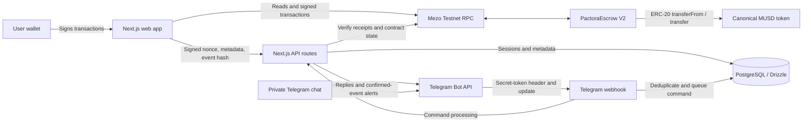
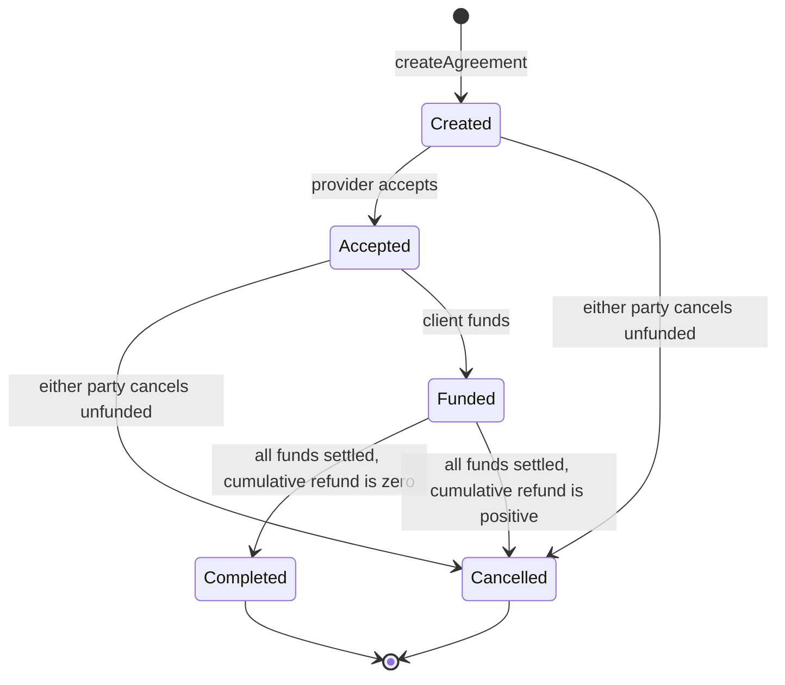
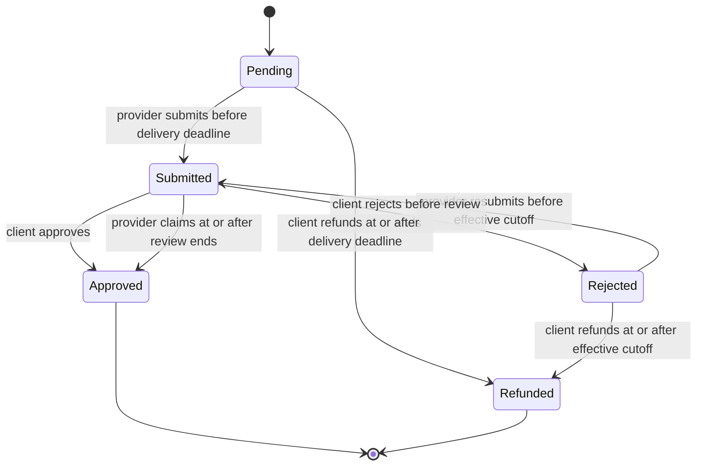
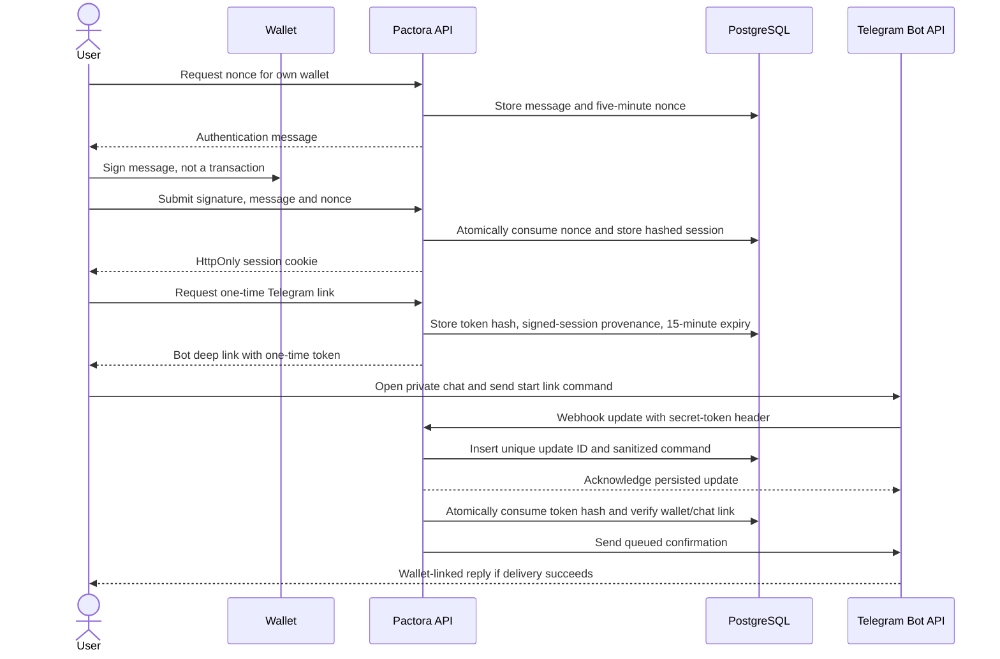

# Pactora Architecture

Last verified: **2026-11-10 UTC**. **Testnet only. Unaudited. No subjective dispute arbitration.**

Pactora coordinates milestone-based MUSD payments between a client and a provider on Mezo Testnet. Wallets sign transactions against the V2 escrow contract; the web app supplies the workflow and public receipts, and Telegram supplies read-only guidance and alerts. Chain state is authoritative for agreement IDs, parties, milestone states and accounting. PostgreSQL stores human-readable metadata and operational records for authentication, linking and delivery, not authoritative balances or escrow funds.

This document describes the current [contract source](../contracts/src/PactoraEscrow.sol), [API routes](../app/api), [chain helpers](../lib/chain), [Telegram handlers](../lib/telegram) and [database schema](../lib/db/schema.ts). Live verification is recorded separately in [deployments](deployments.md).

## Components



The bot never holds wallet keys or signs a payment. There is no event indexer or always-running delivery worker in the current implementation. Next.js `after()` processes queued work after the response.

## Agreement States

The enum values come from `AgreementState` in `PactoraEscrow.sol`.



| State | Who can move it | Function | Event |
| --- | --- | --- | --- |
| `Created (0)` | Creator becomes client; designated provider can accept; either party can cancel | `createAgreement`, `acceptAgreement`, `cancelUnfundedAgreement` | `AgreementCreated`, `AgreementAccepted`, `AgreementCancelled` |
| `Accepted (1)` | Client funds; either party can cancel before funding | `fundAgreement`, `cancelUnfundedAgreement` | `AgreementFunded`, `AgreementCancelled` |
| `Funded (2)` | Client approves or refunds eligible milestones; provider claims eligible timeouts; the counterparty accepts a mutual split | `approveMilestone`, `refundNoShow`, `claimAfterTimeout`, `acceptResolutionProposal` | Milestone/settlement events; `AgreementCompleted` or `AgreementCancelled` when fully settled |
| `Completed (3)` | Terminal; no further payment transition | `_closeIfSettled` after the final release or settlement | `AgreementCompleted` |
| `Cancelled (4)` | Terminal; cancellation before funding or fully settled with any cumulative refund | `cancelUnfundedAgreement` or `_closeIfSettled` | `AgreementCancelled` |

Closure is accounting-based: `releasedAmount + refundedAmount == totalAmount`. `Completed` requires cumulative `refundedAmount == 0`; otherwise closure is `Cancelled`. A mutual settlement does not change every milestone to Approved or Refunded. A full-provider settlement can therefore complete an agreement with unchanged milestone states. `AgreementCancelled.refundAmount` is the cumulative refund on funded closure, not another transfer.

## Milestone States

Each agreement has 1-50 positive milestone amounts. `createAgreement` sums them into `totalAmount`; the web wizard currently limits additions to 20.



| State | Who can move it | Function | Event |
| --- | --- | --- | --- |
| `Pending (0)` | Provider submits; client refunds after the agreed cutoff | `submitMilestone`, `refundNoShow` | `MilestoneSubmitted`, `MilestoneRefunded` |
| `Submitted (1)` | Client approves or rejects; provider claims after review timeout | `approveMilestone`, `rejectMilestone`, `claimAfterTimeout` | `MilestoneApproved`, `MilestoneRejected`; timeout emits both `MilestoneTimeoutClaimed` and `MilestoneApproved` |
| `Approved (2)` | Terminal for milestone actions; full milestone amount has been released | `_releaseMilestone` | `MilestoneApproved` |
| `Rejected (3)` | Provider resubmits; client refunds after the effective cutoff | `submitMilestone`, `refundNoShow` | `MilestoneSubmitted`, `MilestoneRefunded` |
| `Refunded (4)` | Terminal for milestone actions; full milestone amount has been returned | `refundNoShow` | `MilestoneRefunded` |

All milestone mutations require the agreement to remain `Funded`. Milestone indices are zero-based in the contract and one-based in bot messages.

## Money Flow and Time Windows

`REVIEW_WINDOW` is exactly **7 days = 604,800 seconds**, verified in source and by the live getter. All contract cutoffs use `block.timestamp`, not the user's clock.

| Step | Implemented rule |
| --- | --- |
| Agree | Client supplies future per-milestone `uint64` delivery deadlines and a `bytes32` terms hash. The provider explicitly accepts. Acceptance itself has no expiry check. |
| Allowance | Client signs MUSD `approve(escrow, amount)`. This authorizes a transfer; it does not deposit funds or change the agreement state. |
| Deposit | A separate `fundAgreement(id)` transaction transfers the full total from client to escrow. Every original delivery deadline must still be strictly in the future. There is no partial deposit path. |
| Deliver | Provider calls `submitMilestone` from Pending or Rejected strictly before the effective submission cutoff. A submission resets `submittedAt` and clears the rejection fields. |
| Approve and release | Client calls `approveMilestone` on Submitted work. It releases that milestone's full amount to the provider. Approval has no additional review-window cutoff. |
| Reject | Client calls `rejectMilestone` only while `block.timestamp < submittedAt + 604800`. |
| Review-timeout claim | Provider calls `claimAfterTimeout` only while `block.timestamp >= submittedAt + 604800` and the milestone is still Submitted. It releases the full amount and marks Approved. It is a transaction, not an automatic payout. |
| Pending no-show refund | Client calls `refundNoShow` only while `block.timestamp >= deliveryDeadline` and the milestone is still Pending. |
| Rejected-work cutoff | `_submissionDeadline` is `max(deliveryDeadline, rejectedAt + 604800)`. Resubmission must be strictly before it; client refund starts at equality. |
| Submitted-work protection | `refundNoShow` never accepts Submitted work, even after the original delivery deadline. |

Repeated timely rejection/resubmission cycles can refresh these windows; the contract sets no maximum revision count. None of these rules determines deliverable quality.

Funding uses `SafeERC20.safeTransferFrom` and checks the exact client debit and escrow credit. Releases/refunds use `_transferExact`, which checks the exact escrow debit and recipient credit. The deployment script constructs V2 with canonical MUSD and enforced allowlisting. The generic contract can admit other contract tokens through the owner's allowlist, but the current app and notification path support canonical MUSD only.

## Hash-Bound Mutual Settlement

Either party calls `proposeResolution(id, clientRefundAmount, providerReleaseAmount)` while Funded. The two amounts must exactly split the remaining balance. Either party can replace an active proposal; only its proposer can call `cancelResolutionProposal`.

The proposal identity is:

```text
keccak256(abi.encode(
    address(this), block.chainid, agreementId, persistentProposalNonce,
    msg.sender, clientRefundAmount, providerReleaseAmount
))
```

The per-agreement nonce increments for each proposal and survives deletion. The other party must pass the reviewed `bytes32 expectedProposalHash` to `acceptResolutionProposal(id, expectedProposalHash)`. The contract rejects self-acceptance, a changed hash or amounts no longer matching the remaining balance.

Approval, timeout release and no-show refund invalidate active proposals. Replacement and explicit cancellation emit `ResolutionCancelled`; proposing emits `ResolutionProposed`. Submission and rejection do not invalidate proposals because they do not change the remaining balance. There is no proposal expiry. Acceptance emits `ResolutionAccepted`, updates accounting, closes the agreement and transfers the agreed split. No administrator arbitrates or overrides a payment.

## Agreement IDs and Terms

`nextAgreementId` starts at 1. `createAgreement` assigns `nextAgreementId++` and emits `AgreementCreated`. The app's [creation decoder](../lib/chain/creation.ts) extracts the ID from a successful receipt from the configured escrow, checking the expected client/provider. The database never invents an agreement ID.

Metadata identity includes chain, escrow address and on-chain ID. `/api/agreements` verifies the creation receipt, parties, token, amounts, deadlines and terms commitment before immutable registration. Unverified legacy metadata is not authoritative. Missing/default structs render **"Agreement not found on this contract"**; they are not interpreted as Created agreements with zero balances.

The app's [terms helper](../lib/chain/terms.ts) computes keccak256 over UTF-8 JSON with fixed field order: title, description, lowercased client/provider and milestone title, amount text, description and numeric delivery deadline. The hash does not itself include token, total, chain, escrow or ID; the API checks those separately. Deliverable/rejection hashes commit to the supplied text or URL string, not fetched URL contents or proof of quality. SHA-256 is used for session/link-token storage, not these terms.

## Telegram Linking



Wallet authentication uses a custom **SIWE-style signed nonce**, not an EIP-4361 SIWE parser. The webhook checks `X-Telegram-Bot-Api-Secret-Token` using equal-byte-length comparison and `timingSafeEqual`. It is shared-secret header verification, not an HMAC signature.

Only private messages whose non-bot sender ID equals the chat ID execute commands. Unique `update_id` insertion deduplicates deliveries. Raw link tokens and raw message payloads are not persisted. A queued update is claimed from Pending before execution; delivery is best-effort and has no automatic crash recovery.

| Command | Actual behavior |
| --- | --- |
| `/start` | Welcome and linking instructions; `/start link_<token>` consumes the one-time link |
| `/help` | Commands, test-funds guide and wallet safety |
| `/balance` | Linked wallet's canonical MUSD and BTC gas balance at one block snapshot |
| `/agreements` | Discovered on-chain states and next actions for the linked wallet |
| `/pending` | Funded work awaiting client review or provider delivery/resubmission |
| `/getmusd` | Links to the Mezo faucet and testnet swap/borrowing app |
| `/notifications` | Toggle alerts for a verified linked wallet |
| `/unlink` | Remove the chat link and revoke its unused link tokens |

There is no `/link` command or payment-signing bot command. No callback-query handler is implemented.

### Confirmed-Event Notifications

The app calls `/api/notifications/confirmed` with a transaction hash after confirmation. The server independently reads a successful Mezo receipt, filters logs to the configured escrow and checks that the authenticated wallet is an agreement party. Only verified linked participants with enabled preferences receive queued alerts.

The [notification handler](../lib/telegram/notifications.ts) recognizes `AgreementCreated`, `AgreementAccepted`, `AgreementFunded`, `MilestoneSubmitted`, `MilestoneApproved`, `MilestoneRejected`, `MilestoneTimeoutClaimed`, `MilestoneRefunded`, `ResolutionProposed`, `ResolutionAccepted`, `ResolutionCancelled`, `AgreementCompleted` and `AgreementCancelled`. An outbox key binds chain, escrow, transaction hash, log index and recipient user ID. `TokenAllowlistUpdated` is not an agreement alert. The separate test-alert route labels its message as not a chain event.

The app waits for one receipt confirmation. The server has no additional confirmation-depth or independent RPC quorum check; "confirmed" here means a successful mined receipt. External-wallet transactions do not automatically notify unless the confirmed-event endpoint is called. Pending/failed jobs can be requeued by the same event request, but no scheduled retry or indexer is shipped.

## API Surface

Limits below are per 60 seconds, stored in PostgreSQL. Authentication endpoints use a trusted Vercel IP or shared route bucket; authenticated mutation limits use the wallet; the webhook uses private chat ID.

| Route | Methods | Access and handler rate limit |
| --- | --- | --- |
| `/api/auth/nonce` | POST | Same origin; 10 requests |
| `/api/auth/verify` | POST | Same origin and valid signed nonce; 20 requests |
| `/api/auth/session` | GET | Session required; no explicit handler rate limit |
| `/api/auth/logout` | POST | Same origin; clears current token if present; no explicit handler rate limit |
| `/api/agreements` | GET, POST | GET: own signed-session wallet; POST: verified client/receipt, same origin, 10 registrations |
| `/api/agreements/[id]` | GET | Signed-session agreement party; no explicit handler rate limit |
| `/api/agreements/[id]/evidence` | GET, POST | Party-only GET; POST additionally checks author and confirmed hash, same origin, 20 writes |
| `/api/telegram/link` | GET, POST, DELETE | Own signed session; POST/DELETE require same origin and allow 5 requests each |
| `/api/telegram/webhook` | POST | Required secret-token header; 60 private-chat updates |
| `/api/notifications/confirmed` | POST | Same origin, signed-session party, successful receipt; 30 requests |
| `/api/notifications/test` | POST | Production opt-in, same origin, verified linked session; 3 requests |
| `/api/receipts/[id]` | GET | Public; configured V2 or explicit legacy V1 address; no explicit handler rate limit |
| `/api/health` | GET | Public escrow readiness checks, not database health; no explicit handler rate limit |

## Data Model

| Table | Purpose |
| --- | --- |
| `users` | Normalized unique wallet identity |
| `auth_nonces` | Authentication message, five-minute nonce and consumption status |
| `wallet_sessions` | Session-token hashes and 24-hour expiry |
| `telegram_links` | Unique wallet/chat link, ownership provenance and alert preference |
| `telegram_link_tokens` | One-time token hashes, signed-session provenance, expiry and consumption |
| `rate_limits` | Hashed identity buckets with atomic counters and expiry |
| `agreement_metadata` | Human-readable terms and chain-checked identity/amount/deadline metadata |
| `milestone_evidence` | Receipt-verified submission/rejection text, hash and event location |
| `webhook_events` | Unique update ID, sanitized command and processing status |
| `notification_jobs` | Unique event/recipient key, message and pending/sending/sent/failed delivery state |

## Discovery and Receipt Limits

The web dashboard lists at most 50 verified registered metadata rows for the wallet, rechecking their chain state. Telegram unions at most 50 registered metadata IDs with the first 50 on-chain IDs, then filters to the wallet's actual agreements. It can therefore check up to 100 candidate IDs; `/agreements` displays at most 8 and `/pending` at most 10 items per reply. Unregistered IDs beyond 50 may be absent. Direct agreement/receipt reads by a known ID are separate from discovery.

Public receipt history scans at most the recent 100,000-block window, adding creation and closure anchors for older agreements and reporting `historyComplete`. It is not a complete historical index. A resumable confirmed-event indexer and scheduled delivery retry are [planned Wave 2 work](wave-2.md), not current features.

## Network Parameters

| Parameter | Value and evidence |
| --- | --- |
| Chain | Mezo Testnet, `31611` / `0x7b7b`; source registry and live RPC |
| RPC | https://rpc.test.mezo.org; fixed in the current chain helpers |
| Explorer | https://explorer.test.mezo.org |
| Token | Canonical MUSD, `0x118917a40FAF1CD7a13dB0Ef56C86De7973Ac503`; official reference and V2 `defaultToken()` |
| Token precision | 18 decimals; live `decimals()` read |
| Gas currency | BTC, 18 decimals; `mezoTestnet.nativeCurrency` |
| Test-funds links | https://faucet.test.mezo.org/ and https://testnet.mezo.org |

## V1 Versus V2

V1 comparison is backed by `git show b773f72:contracts/src/PactoraEscrow.sol`, its public deployment record and the read-only [legacy ABI](../lib/chain/abi/LegacyPactoraEscrow.ts). V1 remains immutable.

| Area | V1, legacy | V2 source |
| --- | --- | --- |
| Contract identity | No `VERSION()` getter | `VERSION() == 2` |
| Delivery | No contract delivery deadlines | Agreed deadlines; funding/submission cutoff checks |
| Client silence | No provider timeout claim | `claimAfterTimeout` after 604,800 seconds |
| Provider no-show | No guarded milestone refund | `refundNoShow` for eligible Pending/Rejected milestones |
| Milestone enum | Pending, Submitted, Approved, Rejected | Adds Refunded and timing fields |
| Settlement consent | Acceptance takes only an ID; proposal can be replaced | Expected hash binds contract, chain, ID, nonce, proposer and split |
| Terminal settlement | Mutual settlement always Cancelled | Completed only if cumulative refund is zero; otherwise Cancelled |
| Token accounting | Nominal SafeERC20 amounts; no exact balance-delta checks | Exact debit/credit checks; deployment enforces MUSD allowlisting |
| Token validation | Allowlist mode can admit a non-contract address | Nonzero contract required at creation; owner cannot allow an EOA |
| Application identity | Legacy metadata is not treated as proof | Receipt-derived IDs and verified chain/escrow-scoped registration |

## Contract Reference

All callers can read `getAgreement`, `getMilestone`, `getMilestones`, `getResolutionProposal`, `getAgreementCount`, `getRemainingBalance`, `isTokenAllowed` and generated getters `VERSION`, `REVIEW_WINDOW`, `nextAgreementId`, `defaultToken`, `owner`, `allowedTokens`, `enforceTokenAllowlist`. Mapping views can return default structs for missing IDs; the application performs existence checks. The owner-only mutation is `setTokenAllowed`, emitting `TokenAllowlistUpdated`. All other mutation access rules are in the [security function table](security.md#contract-access).

Declared custom errors are grouped below. SafeERC20/reentrancy errors also appear in the ABI.

| Group | Errors |
| --- | --- |
| Identity/access | `InvalidAddress`, `AgreementDoesNotExist`, `NotClient`, `NotProvider`, `NotParty`, `NotOwner` |
| State/milestones | `InvalidAgreementState`, `InvalidMilestones`, `MilestoneOutOfBounds`, `MilestoneNotPendingOrRejected`, `MilestoneNotSubmitted`, `MilestoneNotRefundable` |
| Timing | `InvalidDeliveryDeadline`, `DeliveryDeadlinePassed`, `DeliveryDeadlineNotReached`, `ReviewWindowOpen`, `ReviewWindowClosed` |
| Settlement | `InvalidResolutionAmounts`, `NoActiveResolutionProposal`, `CannotAcceptOwnProposal`, `ProposalHashMismatch` |
| Token | `TokenNotAllowed`, `InexactTokenTransfer` |
| Declared but not used as guards | `MilestoneAlreadyApproved`, `ProposalAlreadyPending` |

## Verification Gaps

- **Pending verification:** complete two-wallet funding, submission, approval and payout. The verified live V2 agreement is Accepted and unfunded; creation/acceptance alone is not payment evidence.
- **Pending verification:** signed Telegram linking, all private-chat command replies and confirmed-event delivery. Bot identity/webhook registration does not prove those interactions succeeded.
- **Pending verification:** current production database provider/schema and real PostgreSQL concurrency/rollback behavior. Phase 0 did not connect to the production database.
