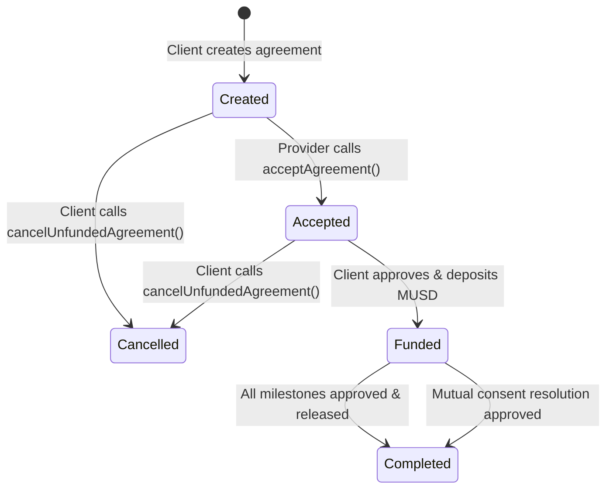
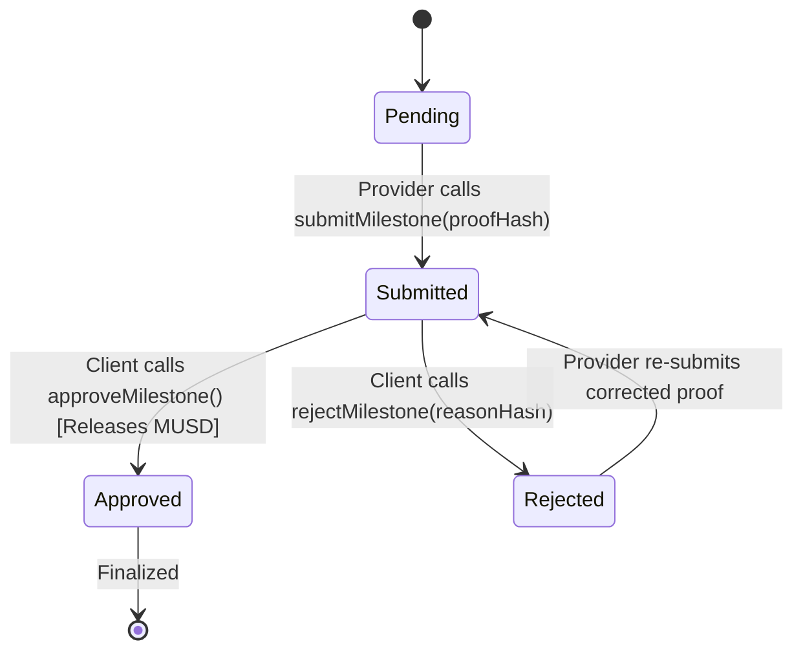
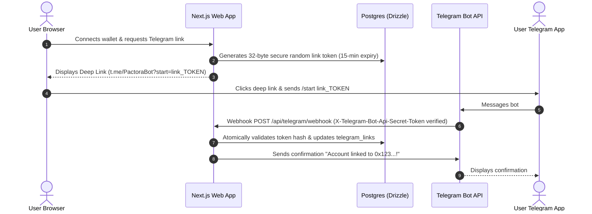

# Pactora System Architecture

Pactora is a non-custodial milestone-based escrow and payment coordination protocol built natively for the Mezo ecosystem. It combines an immutable Solidity escrow engine with a Next.js 15 App Router web application, PostgreSQL / Drizzle ORM state indexing, and a bidirectional Telegram bot for real-time notification delivery and workflow coordination.

---

## 1. High-Level Component Topology

```mermaid
graph TB
    subgraph Client Layer
        Web["Next.js Web Application<br/>(Wagmi v2 + Viem)"]
        TG["Telegram Client<br/>(User & Provider)"]
    end

    subgraph Serverless Edge / Backend
        API["Next.js 15 API Route Handlers"]
        TGWebhook["Telegram Webhook Handler<br/>(/api/telegram/webhook)"]
        AuthService["Signed Nonce Auth<br/>(/api/auth/verify)"]
    end

    subgraph Data & Storage
        DB[(PostgreSQL Database)]
        Drizzle["Drizzle ORM Engine"]
    end

    subgraph Mezo Blockchain (Chain ID: 31611)
        Contract["PactoraEscrow.sol<br/>(ReentrancyGuard, Invariants)"]
        MUSD["Canonical MUSD Token<br/>(0x118917a40FAF1CD7a13dB0Ef56C86De7973Ac503)"]
    end

    Web -->|Direct RPC & Wallet Signatures| Contract
    Web -->|MUSD Approve & Deposit| MUSD
    Web -->|Nonce Request & Sign| AuthService
    Web -->|Off-chain metadata sync| API
    
    TG <-->|Commands & Webhooks| TGWebhook
    TGWebhook --> Drizzle
    AuthService --> Drizzle
    API --> Drizzle
    Drizzle --> DB

    Contract -->|Event Emission| Web
```

---

## 2. Smart Contract State Machine

The core escrow logic is governed by `PactoraEscrow.sol`, ensuring that funds cannot be locked or drained arbitrarily.

### Agreement States
- **Created (0):** The agreement is initialized by the creator specifying the client, provider, milestone breakdown, and terms hash (`keccak256`).
- **Accepted (1):** The provider counter-party signs acceptance of the terms.
- **Funded (2):** The client deposits the total agreement amount in MUSD using safe ERC-20 transfer. Funds are held in contract escrow.
- **Completed (3):** All milestones have reached `Approved` state and total funds have been disbursed to the provider (or mutual resolution executed).
- **Cancelled (4):** The client cancels an unfunded agreement, or a mutual refund resolves 100% back to the client.



### Milestone Lifecycle

Each agreement consists of $N$ milestones where $\sum \text{amount}_i = \text{totalAmount}$.



---

## 3. Mutual Consent Dispute Resolution

If work is contested or scope changes occur mid-project, Pactora does not rely on arbitrary or centralized oracle intervention. Instead, it implements a cryptographic **mutual consent settlement engine**:

1. Either party (client or provider) calls `proposeResolution(agreementId, clientRefund, providerRelease)`.
2. The contract validates the fundamental economic invariant:
   $$\text{clientRefund} + \text{providerRelease} = \text{totalAmount} - \text{releasedAmount} - \text{refundedAmount}$$
3. The opposing party reviews the proposed split on-chain.
4. When the counter-party executes `acceptResolution(agreementId)`, the smart contract atomically:
   - Transfers $\text{clientRefund}$ MUSD back to the client.
   - Transfers $\text{providerRelease}$ MUSD to the provider.
   - Marks the agreement state as `Completed`.
   - Emits `ResolutionExecuted(agreementId, clientRefund, providerRelease)`.

---

## 4. Telegram Notification & Account Linking Architecture

Pactora provides real-time Telegram notifications without compromising user wallet custody or private keys:



### Webhook Security & Idempotency
- **Header Secret Verification:** Every incoming webhook is checked against `process.env.TELEGRAM_WEBHOOK_SECRET` via `X-Telegram-Bot-Api-Secret-Token`.
- **Deduplication:** Update IDs are tracked in `webhook_events`. Repeated deliveries from Telegram retries are acknowledged with HTTP 200 without duplicate execution.
- **Fail-safe fallback:** Missing database connections trigger clean 503 degraded status without crashing the node process.

---

## 5. Mezo Network Configuration & Verification

| Parameter | Value | Verification Source |
| :--- | :--- | :--- |
| **Network Name** | Mezo Testnet | [Mezo Docs](https://mezo.org/docs/developers/) |
| **Chain ID** | `31611` (`0x7b7b`) | Verified via `eth_chainId` RPC call |
| **Gas Token** | BTC (18 decimals) | Native Bitcoin execution model on Mezo |
| **Default RPC** | `https://rpc.test.mezo.org` | Canonical public endpoint |
| **Backup RPC** | `https://mezo-testnet.drpc.org` | Secondary failover endpoint |
| **Block Explorer**| `https://explorer.test.mezo.org`| Blockscout-based Mezo explorer |
| **Canonical MUSD**| `0x118917a40FAF1CD7a13dB0Ef56C86De7973Ac503` | Verified Mezo Testnet ERC-20 contract |

