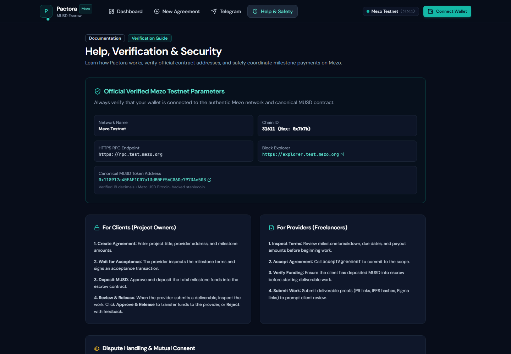

# Project Deck: Eight-Slide Draft

Prepared **2026-11-08**. This is an outline, not a published presentation. The existing V1 site is live; V2 and its full payment/Telegram demonstration are not yet deployed or verified. Preserve those distinctions until the release gates pass.

## Slide 1: Payment Risk Between Milestones

Headline: **Paying for work needs stages.**

- Freelancers want payment confidence; clients want delivery confidence.
- An upfront transfer and an end-of-project payment put risk on different parties.
- Telegram carries the conversation, but does not itself hold a wallet-authorized milestone agreement.
- Use a problem statement, not invented customer quotes, usage statistics, logos, or market metrics.

## Slide 2: MUSD Escrow, Wallet-Owned Decisions

Headline: **Agree, fund, deliver, release.**

- The client creates MUSD amounts and deadlines; the provider accepts before funding.
- Each approved milestone transfers its exact amount from escrow to the provider.
- V2 implements review-timeout claims, guarded no-show refunds, and hash-bound mutual settlement.
- Show an architecture diagram labelled **Implemented V2 source; live upgrade pending** until deployment is verified.
- No custody by the bot, no subjective arbitration, and no fake yield integration.

## Slide 3: The Real Product

Headline: **A live testnet interface, with an honest upgrade boundary.**

Caption: **Real live V1 screenshot from `https://pactora-tan.vercel.app/help`, captured November 8, 2026. It is not V2 functionality or payment evidence.**

- `screenshots/live-v1-help-mobile.png` is the matching real mobile capture; `capture.json` records URL, viewport, time, and release scope.
- The screenshots were captured after visible content readiness, without wallet/provider injection or simulated transactions.
- For the final deck, add a new live V2 workspace/receipt screenshot only after deployment and the real two-wallet demo. Label it with its actual agreement ID and chain, not an invented hash.
- Do not use the old landing animation as proof of real funds. Do not hide the current upgrade status from judges.

## Slide 4: Where MUSD Moves

Headline: **Mezo liquidity becomes milestone payments.**

- Obtain test BTC at the Mezo faucet, then swap for MUSD or use BTC-backed MUSD borrowing in the real Mezo testnet app.
- Client wallet: exact MUSD allowance, then escrow deposit. These are separate transactions.
- Escrow: holds funded milestones and records released/refunded accounting.
- Provider wallet: receives actual MUSD only after an approved release or matured V2 review claim.
- Gas currency is BTC. Token contract is `0x118917a40FAF1CD7a13dB0Ef56C86De7973Ac503` on chain `31611`.
- Final-deck evidence: actual funding and payout hashes, receipt status, token, amount and recipient. Currently pending; do not fabricate examples as live.

## Slide 5: Telegram Removes Coordination Friction

Headline: **Know the next step without reopening every agreement.**

- Signed-session one-time linking binds a private bot chat to a verified wallet.
- `/balance`: MUSD plus test BTC gas balance from Mezo RPC.
- `/agreements`: confirmed state and next action; `/pending`: review/delivery work.
- `/getmusd` and `/help`: Mezo faucet and swap/borrowing guidance.
- `/notifications` and `/unlink`: wallet-owner preferences and control.
- Show actual received replies only after live checks. RPC formatter output is not a screenshot of a delivered Telegram conversation.
- State discovery limit: registered metadata plus the first 50 on-chain IDs; a full indexer is planned.

## Slide 6: Security Without Overclaiming

Headline: **Consent and accounting are explicit.**

- OpenZeppelin `ReentrancyGuard`/`SafeERC20`, exact-transfer checks, and milestone-sum/released/refunded invariants.
- Persistent proposal hashes bind accepted splits; payouts invalidate old proposals.
- Five-minute atomic signed nonces, hashed session/link tokens, persistent rate limits, constant-time secret-token header verification, and server-confirmed chain notifications.
- Local November 7 evidence: **71 Foundry tests**, **125 web/unit tests**, two browser smoke tests; coverage **238/239 lines**, **72/74 branches**. Re-run before final export.
- Tests use visibly labelled Illustration fixtures. A local time-warp test is not seven days passing on a live chain.
- Prominent caveat: **Testnet only. Unaudited. No subjective dispute arbitration.**
- The deployed V1 retains disclosed issues; local V2 source changes do not fix an immutable old contract.

## Slide 7: Track 2 and Real Composability

Headline: **Access to MUSD is also access to useful payments.**

- **Track 2: Access and Distribution** is the entry, not the DeFi/yield track.
- Real integration points: MUSD ERC-20, Mezo Testnet RPC, BTC gas, wallet tooling, explorer links, Telegram and the existing testnet swap/borrowing app.
- The bot guides and coordinates; it does not claim to execute a Mezo loan or hold users' keys.
- MEZO funding, complete indexing, and automated retries are planned, not shipped.
- Business hypothesis: consenting pilots will test whether milestone payments reduce coordination friction. No customer/revenue/retention claims exist yet.

## Slide 8: Milestones Beyond the Buildathon

Headline: **Ship the verified release, then make it reliable.**

- Before the earlier Wave 2 cutoff: owner V2 deploy, schema/config upgrade, real-wallet and Telegram evidence, published source, final deck/video.
- Within four weeks: confirmed-event indexer and delivery retry; MEZO support after address/allowlist/decimals/transfer verification.
- Within six weeks: independent security review and a target of five consenting pilot teams completing ten real testnet agreements.
- Targets are planned work, not already-achieved traction.
- Include actual live/repo/bot links and the verified V2 address only after the release. Current V2 address is unavailable.

## Export Checklist

- [ ] Release evidence in `../deployments.md` is current and all V2 live gates passed.
- [ ] Replace pending V2 screenshots with real captures; keep real hashes readable.
- [ ] All implemented/planned/live claims match the final source and deployment.
- [ ] Export an eight-slide deck and publish its actual share link in `akindo-form.md`.
- [ ] Confirm Wave 2 eligibility and use the earlier AKINDO cutoff unless organizers correct it.
